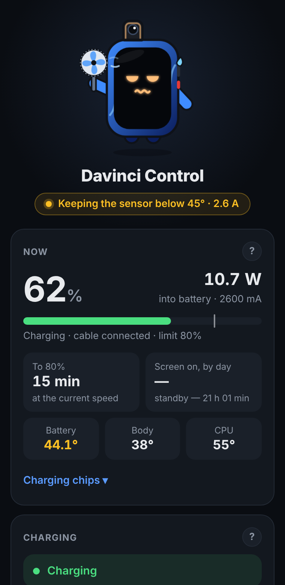
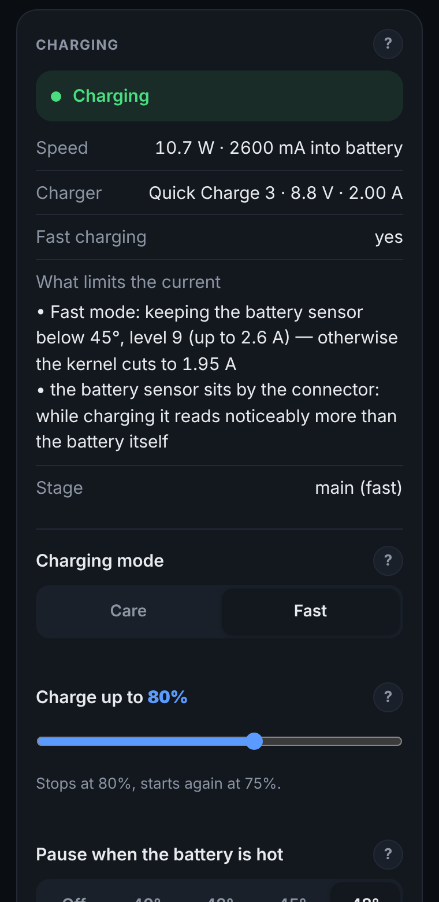
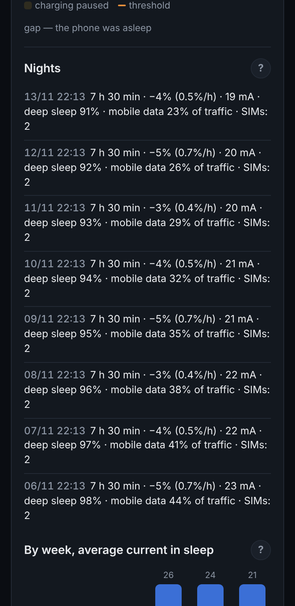

# Davinci Control

Charging, performance and brightness under control for **Xiaomi Mi 9T / Redmi K20 (davinci)**

[Русский](README.md) · **English**

[Download](https://github.com/Rolarn/davinci-control/releases/latest) · [Installation](#installation) · [Compatibility](#compatibility) · [FAQ](docs/FAQ.en.md)

  
  
  

## Is it for you

| ✅ It is for you if | ❌ You don't need it if |
|---|---|
| You have a Mi 9T or Redmi K20 (davinci) with root | Another phone — the module is made only for davinci |
| You want the battery to last longer: a charge limit, no overheating | You want overclocking — the module saves, it does not squeeze |
| You want faster charging without sudden current drops | No root — the module does not work without it |
| You like to see where the charge goes and why | |

## Features

<table>
<tr><td width="110" align="center"></td><td>

### ⚡ Charging
The module watches temperature and current so the battery charges fast where it can and gently where it should.
- **Charge limit** — for example up to 80%, then the phone runs on the cable. A one-time charge to 100% with one button.
- **Care and Fast modes.** In Fast the module keeps the sensor just below 45 °C — above it the kernel sharply cuts current to 1.95 A.
- **Heat pause** with automatic resume.
- **“What limits the current”** in plain words: the charger, heat, the battery itself, the charging chips.
- **Charging sessions:** from–to, time, %/h, average current, temperature, charger, share of time with the screen on.
- **Chip temperatures:** PM6150 charging controller, SMB1390 charge pump, connector.
</td></tr>
<tr><td align="center"></td><td>

### 🚀 Performance
Maximum, Balance and Economy profiles plus fine frequency tuning without a reboot.
- **Frequency limits** for little and big cores.
- **Fixed stock power hints** (powerhint) — fewer needless frequency jumps.
- **The GPU** is not pinned to maximum on heavy rendering.
</td></tr>
<tr><td align="center"></td><td>

### ☀️ Brightness and saver
Rules trigger by themselves when the cable is connected or unplugged.
- **On battery:** auto brightness and Android's Battery Saver.
- **On the cable:** 100% brightness if you want it (off by default).
</td></tr>
<tr><td align="center"></td><td>

### 📊 Statistics and diagnostics
Everything people usually install a separate battery app for.
- **Overnight drain** in % and mA, deep sleep and causes: mobile data share, number of active SIMs.
- **Weekly trend** and a warning if drain went up.
- **Battery wear**, event log, app installs and removals.
- **One-tap diagnostics** — a ready file for a bug report; e-mail, IP and MAC addresses are masked in it.
</td></tr>
<tr><td align="center"></td><td>

### 🛡️ What the module does not do
- Does not disable battery protection in the kernel.
- Does not overclock the CPU or GPU.
- Does not go online and does not collect data.
- Does not change stock thermal configs if they differ from the tested ones.
- Leaves nothing behind: remove the module and everything is as it was.
</td></tr>
</table>

## Compatibility

| Level | What exactly |
|---|---|
| ✅ Tested, fully working | <ul><li>Xiaomi Mi 9T (davinci), 6/64</li><li>PixelOS 15 (BP1A.250505.005, Android 15)</li><li>Kernel 4.14.356-openela-rc1-VantomKernel</li><li>Magisk Alpha 31100</li><li>WebUI X v616</li></ul> |
| 🧩 Supported in code, untested | <ul><li>Stable Magisk 24+ (the Action button needs Magisk 28)</li><li>KernelSU and its forks — replacing files needs a metamodule, e.g. meta-overlayfs</li><li>APatch</li><li>Other AOSP-based ROMs for davinci</li><li>The panel in KsuWebUI or MMRL</li></ul> |
| ⚠️ Partly | <ul><li>MIUI: no powerhint — that part turns itself off</li><li>ROMs with other thermal configs: stock current reduction stays as it is</li><li>Kernels with skip_thermal or disable_thermal on: Care and the hold below 45° do not work, the panel warns you</li></ul> |
| ❌ Not supported | <ul><li>Any other device — the installer refuses</li></ul> |

On start the module checks what of this is available on your ROM and shows it in the panel.

## Installation

1. Download `davinci-control-v1.0.0.zip` from [releases](https://github.com/Rolarn/davinci-control/releases/latest).
2. Open Magisk: <kbd>Modules</kbd> › <kbd>Install from storage</kbd> › pick the zip, then reboot.
3. Tap <kbd>Action</kbd> on the module card — the panel opens (needs the [WebUI X](https://github.com/MMRLApp/WebUI-X-Portable/releases) app, KsuWebUI or MMRL with root). Further updates arrive right in Magisk.

Removal works like for any module: everything goes back to stock after a reboot.

## How it works

In short: the module is a set of shell scripts. A background service looks at the battery every 15–60 seconds and writes to the same kernel nodes the stock thermal protection uses: it turns charging on and off and sets the current limit level. It never wakes the phone from sleep.

**About thermal configs.** The ROM itself cuts charging current when the body warms up (from about 34 °C), using tables in the stock thermal configs. The module can install its own configs without this rule, but only if the stock ones match the tested ones byte for byte — so another ROM cannot be broken. If the files differ, the module leaves them alone and the panel says “left as is”. Battery protection in the kernel always works.

Details are in [How it works](docs/how-it-works.en.md).

## Help

- 📘 [FAQ](docs/FAQ.en.md)
- ⚙️ [How it works](docs/how-it-works.en.md)
- 🐞 [Report a bug](https://github.com/Rolarn/davinci-control/issues/new?template=bug.yml) — attach the diagnostics file from the panel
- 💡 [Ideas for the future](https://github.com/Rolarn/davinci-control/issues?q=label%3Aidea) — what may come

---

Made together with Claude (Anthropic) · © 2026 Rolarn
