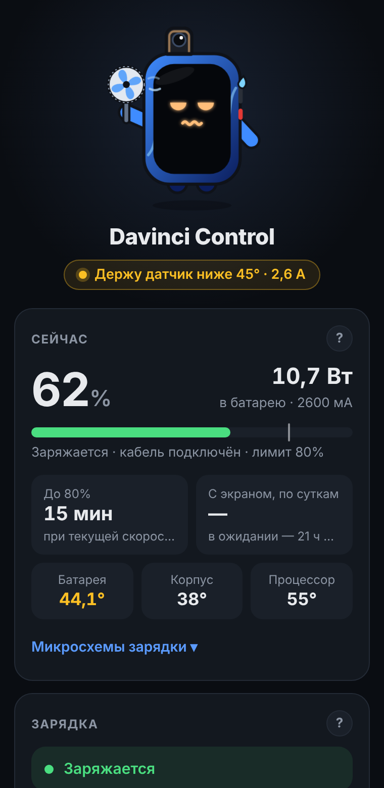
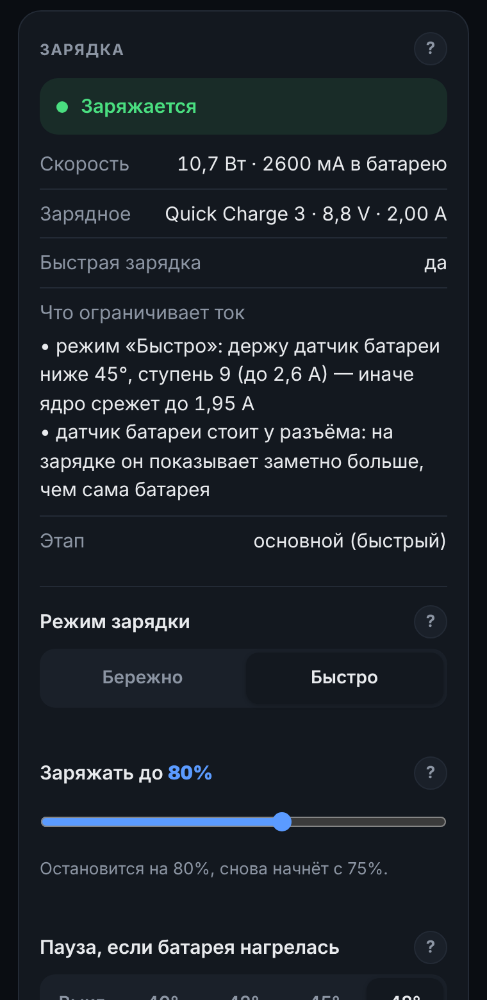
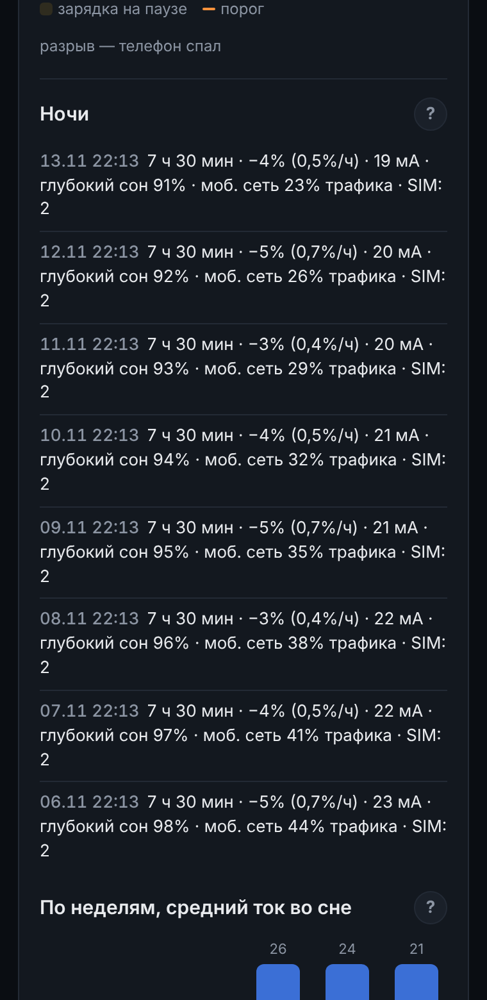

# Davinci Control

Зарядка, производительность и яркость под контролем для **Xiaomi Mi 9T / Redmi K20 (davinci)**

**Русский** · [English](README.en.md)

[Скачать](https://github.com/Rolarn/davinci-control/releases/latest) · [Установка](#установка) · [Совместимость](#совместимость) · [Вопросы и ответы](docs/FAQ.md)

  
  
  

## Подойдёт, если

| ✅ Тебе подойдёт, если | ❌ Не нужен, если |
|---|---|
| У тебя Mi 9T или Redmi K20 (davinci) с root | Другой телефон — модуль сделан только под davinci |
| Хочешь, чтобы батарея дольше жила: лимит заряда, без перегрева | Нужен разгон — модуль бережёт, а не выжимает |
| Хочешь заряжать быстрее, но без резких обрывов тока | Нет root — без него модуль не работает |
| Нравится видеть, куда уходит заряд, и понимать почему | |

## Возможности

<table>
<tr><td width="110" align="center"></td><td>

### ⚡ Зарядка
Модуль следит за температурой и током, чтобы батарея заряжалась быстро там, где можно, и бережно там, где нужно.
- **Лимит заряда** — например, до 80%, дальше телефон питается от кабеля. Разовая зарядка до 100% одной кнопкой.
- **Режимы «Бережно» и «Быстро».** В «Быстром» модуль удерживает датчик чуть ниже 45 °C — выше ядро резко урезает ток до 1,95 А.
- **Пауза при нагреве** с автоматическим продолжением.
- **«Что ограничивает ток»** простым языком: блок питания, нагрев, сама батарея, микросхемы зарядки.
- **Сеансы зарядки:** от–до, время, %/ч, средний ток, температура, блок, доля времени с включённым экраном.
- **Температуры микросхем:** контроллер зарядки PM6150, зарядный насос SMB1390, разъём.
</td></tr>
<tr><td align="center"></td><td>

### 🚀 Производительность
Профили «Максимум», «Баланс», «Экономия» и точная настройка частот без перезагрузки.
- **Пределы частот** малых и больших ядер.
- **Исправление заводских подсказок питания** (powerhint) — меньше лишних скачков частот.
- **Видеочип** не прибит к максимуму при сложной отрисовке.
</td></tr>
<tr><td align="center"></td><td>

### ☀️ Яркость и экономия
Правила срабатывают сами при подключении и отключении кабеля.
- **Без кабеля:** автояркость и системная экономия заряда.
- **На кабеле:** по желанию яркость 100% (по умолчанию выключено).
</td></tr>
<tr><td align="center"></td><td>

### 📊 Статистика и диагностика
Всё, ради чего обычно ставят отдельное приложение для батареи.
- **Расход за ночь** в % и мА, глубокий сон и причины: доля мобильной сети, число активных SIM.
- **Тренд по неделям** и предупреждение, если расход вырос.
- **Износ батареи**, журнал событий, установки и удаления приложений.
- **Диагностика одним касанием** — готовый файл для сообщения об ошибке; почта, IP- и MAC-адреса в нём скрываются.
</td></tr>
<tr><td align="center"></td><td>

### 🛡️ Чего модуль не делает
- Не отключает защиту батареи в ядре.
- Не разгоняет процессор и видеочип.
- Не выходит в интернет и не собирает данные.
- Не меняет заводские файлы нагрева, если они отличаются от проверенных.
- Ничего не оставляет после себя: удалил модуль — всё вернулось как было.
</td></tr>
</table>

## Совместимость

| Уровень | Что именно |
|---|---|
| ✅ Проверено, работает полностью | <ul><li>Xiaomi Mi 9T (davinci), 6/64</li><li>PixelOS 15 (BP1A.250505.005, Android 15)</li><li>Ядро 4.14.356-openela-rc1-VantomKernel</li><li>Magisk Alpha 31100</li><li>WebUI X v616</li></ul> |
| 🧩 Поддержка в коде, не проверено | <ul><li>Стабильный Magisk 24+ (кнопка «Действие» — с Magisk 28)</li><li>KernelSU и его форки — для подмены файлов нужен метамодуль, например meta-overlayfs</li><li>APatch</li><li>Другие прошивки на основе AOSP для davinci</li><li>Панель в KsuWebUI или MMRL</li></ul> |
| ⚠️ Частично | <ul><li>MIUI: нет powerhint — эта часть отключится сама</li><li>Прошивки с другими файлами нагрева: заводское снижение тока останется как есть</li><li>Ядра с включённым skip_thermal или disable_thermal: «Бережно» и удержание ниже 45° не работают, панель предупредит</li></ul> |
| ❌ Не поддерживается | <ul><li>Любые другие устройства — установщик откажет</li></ul> |

При запуске модуль сам проверяет, что из этого доступно на твоей прошивке, и показывает это в панели.

## Установка

1. Скачай `davinci-control-v1.0.0.zip` в [релизах](https://github.com/Rolarn/davinci-control/releases/latest).
2. Открой Magisk: <kbd>Модули</kbd> › <kbd>Установить из хранилища</kbd> › выбери zip, затем перезагрузись.
3. Нажми <kbd>Действие</kbd> на карточке модуля — откроется панель (нужно приложение [WebUI X](https://github.com/MMRLApp/WebUI-X-Portable/releases), KsuWebUI или MMRL с root). Обновления дальше приходят прямо в Magisk.

Удаление — как у любого модуля: всё возвращается к заводскому после перезагрузки.

## Как это работает

Коротко: модуль — набор shell-скриптов. Фоновая служба раз в 15–60 секунд смотрит на батарею и пишет в те же узлы ядра, которыми пользуется заводская термозащита: включает и выключает зарядку, выставляет ступень ограничения тока. Во сне телефона служба не будит его.

**Про файлы нагрева.** Прошивка сама урезает ток зарядки, когда греется корпус (примерно с 34 °C), по таблицам в заводских файлах нагрева. Модуль может поставить свои файлы без этого правила, но только если заводские совпадают с проверенными байт в байт — так нельзя сломать чужую прошивку. Если файлы другие, модуль их не трогает, а в панели будет написано «оставлено как есть». Защита самой батареи в ядре работает всегда.

Подробно — в [«Как это работает»](docs/how-it-works.md).

## Помощь

- 📘 [Вопросы и ответы](docs/FAQ.md)
- ⚙️ [Как это работает](docs/how-it-works.md)
- 🐞 [Сообщить об ошибке](https://github.com/Rolarn/davinci-control/issues/new?template=bug.yml) — приложи файл диагностики из панели
- 💡 [Идеи на будущее](https://github.com/Rolarn/davinci-control/issues?q=label%3Aidea) — что может появиться

---

Сделано вместе с Claude (Anthropic) · © 2026 Rolarn
